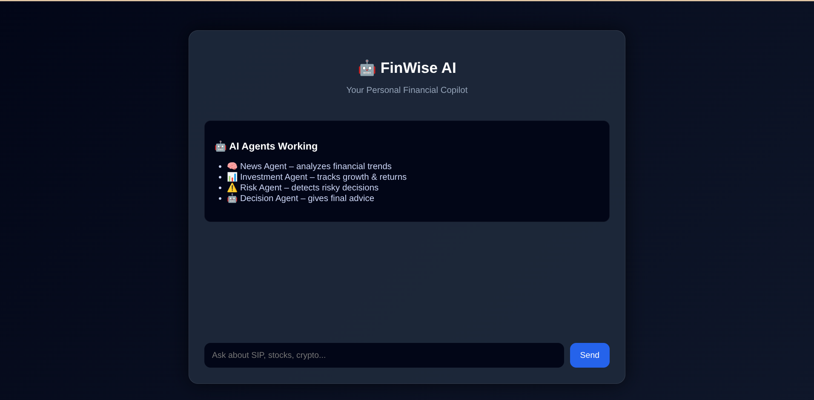
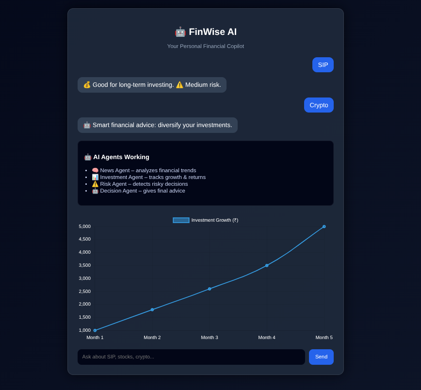

# FinWise AI — Personal Financial Copilot

FinWise AI is an educational finance assistant built with Node.js, Express, Google Gemini, Twelve Data, GNews, and Chart.js. It combines a chat interface, deterministic SIP calculations, optional provider-backed market data, and timestamped financial-news search.

> **Financial safety:** FinWise AI is an educational tool, not a licensed financial adviser, broker, or trading platform. AI-generated explanations may be inaccurate. Market quotes and news are only shown when a provider returns data; data delay and coverage depend on the provider's plan. No return is guaranteed and no personalized buy/sell recommendation is made.

## Features
- Multi-agent financial education workflow: Research, Investment, Risk, and Decision
- SIP future-value calculation in deterministic JavaScript, with explicit assumptions and validation
- Optional market symbol search, quote lookup, and historical time-series data through Twelve Data
- Optional Indian financial-news search through GNews, with article publication timestamps, publishers, and source links
- Chat enrichment for explicit news requests and unambiguous ticker + NSE/BSE quote requests
- In-memory response caching and per-IP throttling to reduce upstream quota abuse
- Email/password accounts through Supabase Auth
- Private per-user conversation history stored in Supabase Postgres with Row Level Security
- Readable Markdown responses, SIP charts, and image-rich financial-news article cards
- Health/readiness endpoints, architecture documentation, and automated CI

## What is live data and what is not
- **Market data:** provider-returned quote and historical time-series data. Market coverage, latency, and real-time entitlement depend on the Twelve Data account and exchange plan. FinWise shows provider timestamps and retrieval time where available.
- **News:** provider-returned GNews article metadata. The GNews Free plan currently advertises a 12-hour delay, a 30-day archive, up to 10 articles per request, and truncated content. Check plan and licensing conditions before public/commercial use.
- **Research Agent:** general AI-generated educational context. It does not independently browse or fetch current market facts.
- **SIP projection:** a deterministic mathematical illustration using the user's stated amount and duration. If the return rate is omitted, 12% is identified as a hypothetical assumption, not an expected return.
- If optional market/news keys are absent or a provider fails, FinWise labels that context unavailable instead of inventing prices or headlines.

## Architecture
See [High-Level Design](docs/HLD.md) and [Low-Level Design](docs/LLD.md).

```text
Browser workspace (public/) ──▶ Supabase Auth + Postgres (user-scoped RLS)
             │
             └─────────────────▶ Express API
                                  ├─ /config: public Supabase URL + anon key
                                  ├─ /chat: input extraction + AI agents
                                  ├─ /investment/sip: deterministic SIP math
                                  └─ /market: Twelve Data + GNews adapters
                                         │
                                         ▼
                                  timestamped provider context
                                         │
                                         ▼
                                  Decision Agent / JSON API
The browser saves each conversation to the signed-in user's Supabase row under RLS. Provider secrets remain on Render.
```

## Tech stack
- **Runtime:** Node.js 20+
- **Backend:** Express.js
- **AI:** Google GenAI SDK / Gemini
- **Market data:** Twelve Data REST API
- **News search:** GNews REST API
- **Frontend:** responsive HTML, CSS, and browser JavaScript workspace
- **Authentication/history:** Supabase Auth + Postgres with Row Level Security
- **Charts:** Chart.js
- **Tests:** Node.js built-in test runner

## Configure API keys
Copy `.env.example` to `.env`. Add provider keys only on the server; never put them into browser JavaScript or commit `.env`.

Required for AI chat:
```env
GEMINI_API_KEY=your_gemini_api_key
GEMINI_MODEL=gemini-3.5-flash-lite
```

Optional market data:
```env
TWELVE_DATA_API_KEY=your_twelve_data_api_key
```
Get a key from [Twelve Data](https://twelvedata.com/). Quote/history availability and freshness depend on the symbols and exchange entitlements in the account.

Optional financial news:
```env
GNEWS_API_KEY=your_gnews_api_key
```
Get a key from [GNews](https://gnews.io/). Its Free plan is delayed and limited; verify current subscription and licensing conditions before public or commercial deployment.

### Supabase accounts and chat history

1. Create a Supabase project and open **Project Settings → API** (or the Connect/API keys page).
2. Copy the project URL into Render as `SUPABASE_URL`.
3. Copy the publishable key (or legacy anon key) into Render as `SUPABASE_ANON_KEY`. Never use the `service_role` key in the browser or in this variable.
4. In the Supabase SQL Editor, run the complete script in [supabase/schema.sql](supabase/schema.sql). It creates the conversations table, enables Row Level Security, and grants each user access only to their own rows.
5. In Supabase Authentication → URL Configuration, set the Site URL to your Render domain: `https://finwise-ai-0753.onrender.com`. Add that same origin to the allowed redirect URLs.
6. Keep email confirmation enabled for public sign-up unless you have a reason to change the project policy. Users may need to confirm their email before their first sign-in.

The browser receives only the Supabase URL and publishable/anon key from `GET /config`. These are public client credentials, not secrets; the database relies on RLS policies using `auth.uid()` for isolation. Do not add a Supabase service-role key to Render for this feature.

Other optional settings: `PORT=3000`, `FRONTEND_ORIGIN=`. The browser UI and API share one origin, so `FRONTEND_ORIGIN` can remain blank.

## Run locally
1. Install Node.js 20 or later.
2. Clone and install:
   ```bash
   git clone https://github.com/Nikki03-tech/Finwise-AI.git
   cd Finwise-AI
   npm ci
   ```
3. Create `.env` and add the keys you have. Gemini is needed for AI chat; market and news keys enable optional provider features.
4. Start:
   ```bash
   npm start
   ```
5. Open [http://localhost:3000](http://localhost:3000).

The server can start without provider keys so health checks and the static UI remain available. A feature requiring a missing key returns a clear unavailable/configuration state.

## HTTP API
### Health
- `GET /health` — liveness plus booleans indicating which provider keys are configured.
- `GET /health/ready` — HTTP 200 when Gemini is configured, otherwise 503.

### Chat
`POST /chat` with `{ "message": "Calculate SIP ₹5,000 per month for 5 years at 10%." }`.

Returns `{ success, reply, data }`. `data` contains research, investment, risk, and financialContext. Investment/risk are null when the question is not a complete SIP scenario. The existing browser fields `reply` and `data.investment.calculation` remain compatible.

### SIP calculator
`POST /investment/sip` with:
```json
{ "monthlyInvestment": 5000, "years": 5, "annualReturn": 10 }
```
Returns deterministic calculation fields, an `annualReturnIsAssumed` flag, and a disclaimer. `annualReturn` can be omitted; FinWise then uses 12% as an explicitly flagged illustration.

### Market data
- `GET /market/search?q=Tata%20Consultancy` — symbol discovery.
- `GET /market/quote?symbol=TCS&exchange=NSE` — provider quote.
- `GET /market/history?symbol=TCS&exchange=NSE&interval=1day&outputsize=30` — time series. Allowed intervals: `1day`, `1week`, `1month`; output size: 5–100.

### News
- `GET /market/news?q=Reserve%20Bank%20of%20India&max=5` — India/English news search sorted by publication time. `max` is 1–10.

Provider errors are converted to client-safe JSON. Typical statuses: 400 invalid input, 404 data unavailable for the requested symbol, 413 request too large, 429 local/provider rate limit, 502 upstream provider error, 503 missing provider configuration.

## Security and operations
- Gemini, Twelve Data, and GNews API keys stay on the server and are not included in successful API responses.
- Supabase browser credentials are the publishable/anon key only. No service-role key is sent to the browser.
- Conversation history is stored in Supabase with RLS policies that scope SELECT/INSERT/UPDATE/DELETE to `auth.uid() = user_id`.
- API request body is capped at 32 KB; chat text at 4,000 characters.
- Chat is throttled to 12 requests per 5 minutes per IP; investment and market/news routes are throttled to 30 per 5 minutes per IP.
- Provider responses are cached in memory (short quote/history/search/news windows).
- The cache and rate limiter are per Node process. For a multi-instance production deployment, use a shared store such as Redis and add authentication/abuse monitoring.
- No user bank credentials, balances, or portfolios are stored. No trades can be placed.

## Render deployment
For the existing Node web service:
- Build command: `npm ci`
- Start command: `npm start`
- Health check: `/health`
- Set `GEMINI_API_KEY` for chat. Set `TWELVE_DATA_API_KEY` and `GNEWS_API_KEY` only after creating provider accounts and confirming plan coverage.
- Set `SUPABASE_URL` and `SUPABASE_ANON_KEY` for sign-up, sign-in, and persistent chat history.
- Run `supabase/schema.sql` once in the Supabase SQL Editor before using history.

Keep the existing Render service/domain. A GitHub commit and green CI do not prove that Render has deployed; verify the deployment in Render and call `/health` after deployment completes.

## Tests
```bash
npm test
```
Tests use injected agents and fake provider responses. They do not require live provider keys or spend Gemini/market/news API quota.

## Screenshots
| Chat interface | Chart visualisation |
| --- | --- |
|  |  |

## Author
**Nikitha Singh Raj Purohit** · B.Tech CSE & IT, Class of 2027
- [GitHub](https://github.com/Nikki03-tech)
- [LinkedIn](https://www.linkedin.com/in/nikitha-singh-raj-purohit-862317301/)
