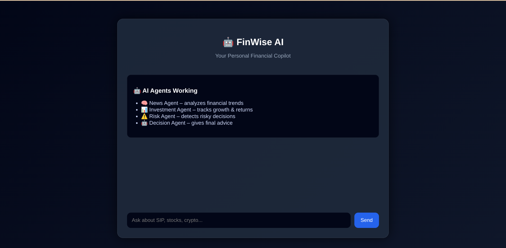
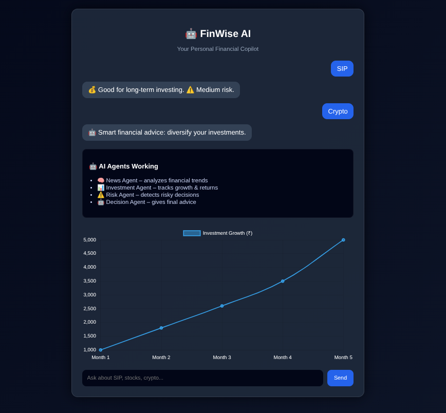

# FinWise AI — Personal Financial Copilot

A Generative AI finance assistant prototype that combines a chat interface with financial data visualisations. It was developed as a project for the ET Gen AI Hackathon.

> **Important:** This is an educational prototype, not a licensed financial adviser. Verify information independently and do not rely on generated output as personalised investment advice.

## Project Highlights

- Chat interface for asking finance-related questions
- Interactive investment-growth visualisation using Chart.js
- Risk-aware response flow
- Backend API built with Node.js and Express
- AI integration using Google's GenAI SDK
- Deployment link for trying the current hosted version

## Architecture (high level)

```text
Browser UI
   ↓
Express API
   ↓
AI response workflow
   ↓
Answer returned to the interface
   ↓
Chart.js visualisation where applicable
```

The multi-agent design described during development includes news, investment, risk, and decision-making responsibilities. Availability of live data and individual capabilities depends on the current implementation and configured API access.

## Tech Stack

- **Frontend:** HTML, CSS, JavaScript
- **Backend:** Node.js, Express.js
- **AI SDK:** Google GenAI
- **Charts:** Chart.js
- **Configuration:** dotenv

## Live Demo

[Try FinWise AI](https://finwise-ai-0753.onrender.com)

The hosted service may take time to wake up or may be temporarily unavailable.

## Run Locally

Requirements: a recent Node.js version and an API key configured for the AI integration.

1. Clone the repository and install dependencies:
   ```bash
   git clone https://github.com/Nikki03-tech/Finwise-AI.git
   cd Finwise-AI
   npm install
   ```
2. Copy `.env.example` to `.env` and add the required key(s). Never commit real API keys.
3. Start the server:
   ```bash
   node server.js
   ```
4. Open the local URL configured by the server (the current project setup uses port 3000).

## Screenshots

| Chat interface | Chart visualisation |
| --- | --- |
|  |  |

## Development

A test script is configured in `package.json`:

```bash
npm test
```

Run it locally to check the current test suite.

## Future Improvements

- Add clearer sources and timestamps for financial information
- Expand automated tests for API and UI flows
- Improve loading, error, and empty states
- Strengthen validation and guardrails for financial queries

## Author

**Nikitha Singh Raj Purohit** · B.Tech CSE & IT, Class of 2027

- [GitHub](https://github.com/Nikki03-tech)
- [LinkedIn](https://www.linkedin.com/in/nikitha-singh-raj-purohit-862317301/)
