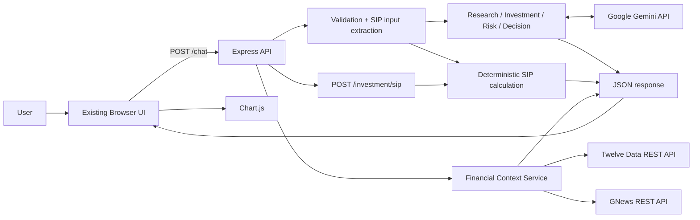
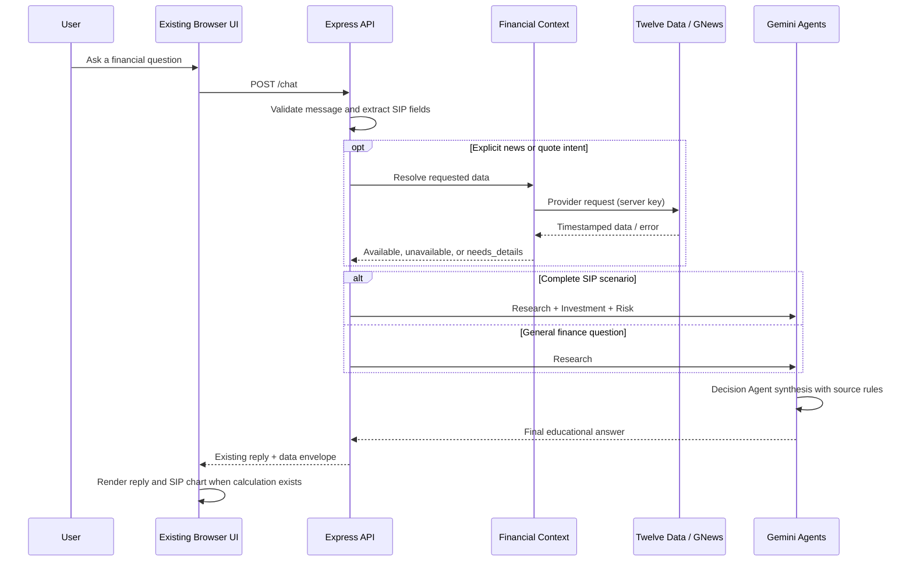

# FinWise AI — High-Level Design

## 1. Purpose and scope
FinWise AI is an educational financial copilot. The browser chat uses Gemini-powered agents for explanations, deterministic JavaScript for SIP projections, and optional external providers for stock-market quotes/history and financial news.

It is not an adviser, broker, portfolio manager, exchange, or trading platform. It does not place trades or connect to users' financial accounts.

## 2. System context

## 3. Main components
- **Browser UI:** Existing static HTML, CSS, and browser JavaScript in `public/`. Kept unchanged during backend integration.
- **Express application:** Serves the static UI, exposes chat, SIP, and market/news routes, enforces request limits, and provides health checks.
- **Chat controller:** Validates prompts, extracts SIP inputs, invokes relevant agents, enriches explicit data requests, and preserves the existing response envelope.
- **Investment controller:** Exposes a deterministic SIP calculator independently from chat.
- **SIP calculation service:** Deterministic future-value calculation with validation and beginning-of-month contribution timing.
- **AI agents:** Research (general knowledge), Investment (SIP explanation), Risk (scenario risks), and Decision (final synthesis).
- **Financial Context Service:** Requests news only for explicit news/headline prompts. Requests a quote only when the user includes a stock symbol and NSE/BSE. Missing details or unavailable providers are explicitly labeled.
- **Twelve Data service:** Symbol search, quote, and historical time-series adapters with server-side credentials, timeouts, validation, and short-lived cache.
- **GNews service:** Search adapter that returns publisher, publication time, article URL, and retrieval time.
- **Gemini service:** Lazily creates the AI client from server configuration; provider errors are normalized.
- **Chart.js:** Continues to render SIP data returned by the backend.

## 4. Request flow

## 5. HTTP surface
- `GET /health` — liveness and provider-configuration booleans.
- `GET /health/ready` — readiness for Gemini-backed chat.
- `POST /chat` — financial education and optional context enrichment.
- `POST /investment/sip` — standalone deterministic SIP calculation.
- `GET /market/search` — discover exchange symbols.
- `GET /market/quote` — retrieve one provider quote.
- `GET /market/history` — retrieve bounded daily/weekly/monthly series.
- `GET /market/news` — search GNews articles.

## 6. Deployment and configuration
Single Node.js web service. Build: `npm ci`; start: `npm start`; health: `/health`.

Secrets: `GEMINI_API_KEY` (chat), `TWELVE_DATA_API_KEY` (quotes/history), `GNEWS_API_KEY` (news). Optional: `GEMINI_MODEL`, `PORT`, `FRONTEND_ORIGIN`.

Static browser assets and API share the same origin, so the existing frontend does not need a base-URL change.

## 7. Reliability and safety
- API keys stay on the server; provider keys are not sent to the browser.
- Upstream requests have timeouts, provider-aware errors, and bounded caches.
- SIP inputs are validated before Gemini calls; no default monthly contribution or duration is invented.
- Quote data is fetched only for explicit symbol + exchange requests. News context is fetched only for explicit news intent.
- Decision prompts prohibit making up current prices, dates, publishers, headlines, or source URLs, and treat external article text as untrusted reference data.
- Provider timestamps and retrieval timestamps are kept separately.
- Request body is capped at 32 KB and chat text at 4,000 characters.
- Per-IP limits protect chat and upstream market/news quotas.
- No broker execution, investment accounts, bank credentials, or persistent financial profile is implemented.

## 8. Known limitations
- Twelve Data symbol coverage, price delay, and real-time entitlements vary by account plan and exchange.
- GNews Free plan currently lists 100 requests/day, up to 10 articles/request, a 12-hour delay, a 30-day archive, and truncated content. Verify plan and licensing terms before public/commercial use.
- The current cache and IP rate limiter are in-memory and per process; horizontally scaled production needs a shared cache/limiter such as Redis.
- There is no user authentication, persistent database, audit log, portfolio integration, alerting, or broker connection.
- AI explanations can be wrong; all output is educational and requires independent verification.
