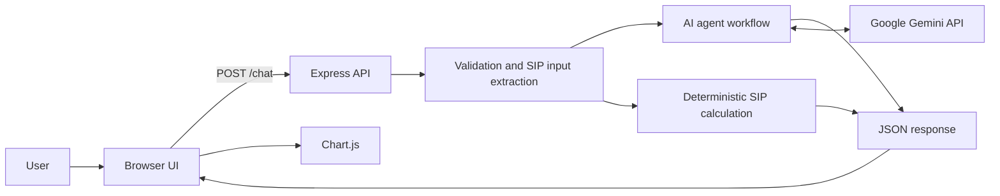
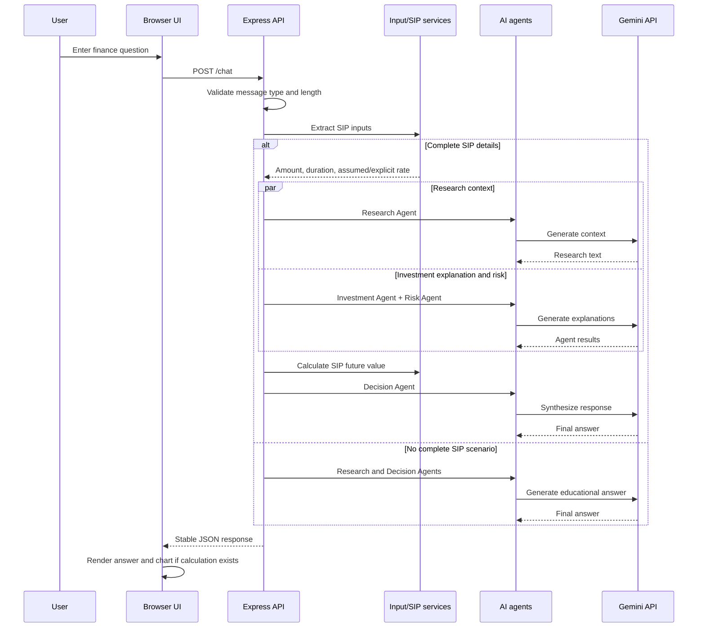

# FinWise AI — High-Level Design

## 1. Purpose and scope
FinWise AI is an educational financial copilot prototype. It accepts finance questions through a browser chat interface, uses Gemini-powered agents to compose an explanation, and returns deterministic SIP projection data for Chart.js when the user supplies a complete SIP scenario.

It is not a financial adviser, broker, trading system, portfolio manager, or live market-data platform.

## 2. System context

## 3. Main components
- **Browser UI:** Static HTML, CSS, and JavaScript in public/. It renders chat messages and returned chart data.
- **Express application:** Serves the static UI, exposes /chat, and provides liveness/readiness checks.
- **Input extraction:** Detects an SIP request and extracts only explicitly supplied contribution and duration values.
- **Research Agent:** Uses Gemini to explain general financial concepts. It has no connected live news or market feed.
- **Investment Agent:** Calls the deterministic SIP calculation service and asks Gemini to explain the resulting numbers.
- **Risk Agent:** Generates general risk context for an identified SIP scenario.
- **Decision Agent:** Combines available agent outputs into a concise response.
- **Gemini service:** Loads credentials only when an AI request is made and calls the configured model.
- **Chart.js:** Displays SIP values returned by the backend.

## 4. Request flow

## 5. Deployment view
The application is designed as one Node.js web service. Build command: npm ci. Start command: npm start. Liveness health check: GET /health. Runtime secret: GEMINI_API_KEY. Optional model override: GEMINI_MODEL.

The static frontend and API share the same origin. This avoids requiring a separate frontend deployment or changing browser API URLs.

## 6. Reliability and security
- API request body is capped at 32 KB; chat message length is capped at 4,000 characters.
- Invalid JSON and oversized bodies receive controlled error responses.
- Gemini credentials are not required for the Node process to boot or respond to liveness checks.
- AI provider errors are logged server-side and returned as generic client-safe errors.
- x-powered-by is disabled.
- CORS is not opened to arbitrary origins; a specific origin can be configured if a separate frontend is introduced.
- No real financial account credentials or personal financial records are stored by this prototype.

## 7. Known limitations
- AI explanations may be inaccurate and must be independently verified.
- Research responses are generated from model knowledge; no current market/news retrieval is wired in.
- The SIP chart is an illustration based on a hypothetical annual rate and beginning-of-month contribution timing.
- There is no user authentication, database, rate limiter, audit log, or persistent chat history.
- Empty market and separate investment route placeholders are not active product features.
